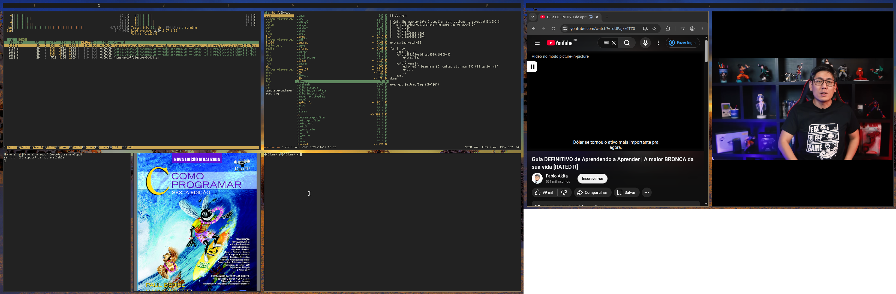

<div align="center">
<pre style="background: transparent; border: none; color: inherit;">
    ██████   ███                                 
   ███░░███ ░░░                                  
  ░███ ░░░  ████  █████ ███ █████ █████████████  
 ███████   ░░███ ░░███ ░███░░███ ░░███░░███░░███ 
░░░███░     ░███  ░███ ░███ ░███  ░███ ░███ ░███ 
  ░███      ░███  ░░███████████   ░███ ░███ ░███ 
  █████     █████  ░░████░████    █████░███ █████
 ░░░░░     ░░░░░    ░░░░ ░░░░    ░░░░░ ░░░ ░░░░░ 
</pre>

**fiwm** — *Freestanding Independence Window Manager*  
Gerenciador de janelas BSP (tiling) em **Assembly x86_64 puro** para X11.  
Zero C, zero libc, zero libX11 — comunicação direta via protocolo wire sobre soquete Unix.

<br>

</div>

---

## ⚡ Métricas e Pegada de Memória

| Segmento / Métrica | Tamanho | Descrição |
|:---|:---:|:---|
| **`.text`** | **5.490 B** (~5,4 KB) | Código de máquina executável puro (BSP/floating SSE2, hash O(1) e atalhos) |
| **`.data`** | **567 B** | Estruturas de soquete Unix, vetores SIMD, strings estáticas e template `sh_argv` único |
| **`.bss`** | **5.616 B** (~5,5 KB) | Buffers de I/O compactados e pool L1 de 64 nós BSP |
| **Total Mapeado (ELF)** | **11.673 B** (~11,4 KB) | Cabe inteiramente em 3 páginas físicas de 4 KB x86_64 (`0x400078`–`0x402e20`) |
| **Tamanho do Binário em Disco** | **6,4 KB** (6.536 B) | Executável final estático e stripped (sem dependências dinâmicas) |
| **RAM em Execução (`VmRSS` / `VmData`)** | **24 kB / 12 kB** | Pico ativo (`VmHWM`) de apenas 24 kB mesmo com janelas abertas (3 páginas ELF) |
| **Consumo de Pilha (Stack)** | **0 B** | Arquitetura zero-stack com invariantes globais em registradores |
| **Tempo de Startup a Frio** | **~0,55 ms** | Handshake Xinerama/Atoms isolado, barra, grabs e disparo final do autostart |

---

## ✨ Recursos

- **Layout BSP Hierárquico**: Divisão automática de janelas em árvore binária com splits horizontal (`Alt+v`) e vertical (`Alt+b`).
- **Navegação Espacial 2D**: Foco e troca direta de janelas nas quatro direções via `HJKL`.
- **Dual-Monitor / Xinerama**: Autodetecção transparente de múltiplos monitores sem dependência de bibliotecas externas.
- **9 Workspaces com Barra Integrada**: Barra de status nativa desenhada diretamente em preto, ouro e cinza via texto bruto X11.
- **Modos Tela Cheia e Flutuante**: Alternância instantânea de apresentação via pacote atômico unificado.
- **Zero Libc & Zero Dependências**: Ponto de entrada direto em `_start`, utilizando apenas a instrução `syscall`.

---

## ⌨️ Atalhos Principais

O modificador padrão é **Alt** (`Mod1Mask`).

### Janelas e Layout
| Atalho | Ação |
|:---|:---|
| `Alt + Enter` / `Alt + W` | Abrir terminal |
| `Alt + D` | Abrir lançador de aplicativos / menu |
| `Alt + Q` | Fechar janela em foco (ICCCM `WM_DELETE_WINDOW`) |
| `Alt + Shift + Q` | Encerrar o fiwm de forma limpa |
| `Alt + F` | Alternar modo Tela Cheia (Fullscreen) |
| `Alt + Shift + F` / `Alt + Space` | Alternar modo Janela Flutuante (Floating) |
| `Alt + V` | Próxima divisão horizontal |
| `Alt + B` | Próxima divisão vertical |

### Navegação e Troca Espacial 2D
| Atalho | Ação |
|:---|:---|
| `Alt + H / J / K / L` | Focar janela à Esquerda / Abaixo / Acima / Direita |
| `Alt + Shift + H / J / K / L` | Trocar posição física com janela à Esquerda / Abaixo / Acima / Direita |

### Workspaces e Monitores
| Atalho | Ação |
|:---|:---|
| `Alt + 1` .. `9` | Mudar para a área de trabalho 1 a 9 |
| `Alt + Shift + 1` .. `9` | Mover janela focada para a área de trabalho 1 a 9 |
| `Alt + A` / `Alt + S` | Ciclar ciclicamente entre áreas de trabalho anterior / próxima |

### Mouse
| Ação com Mouse | Efeito |
|:---|:---|
| `Alt + Botão 1 (Arrastar)` | Mover janela flutuante |
| `Alt + Botão 3 (Arrastar)` | Redimensionar janela flutuante |
| `Clique na Barra` | Alternar diretamente para a área de trabalho clicada |

---

## 🛠️ Compilação e Execução

### Compilar
Requer apenas `as` (GNU Assembler) e `ld` (GNU Linker):

```sh
make fiwmasm
```

### Executar
Pode ser iniciado diretamente a partir do seu `~/.xinitrc`:

```sh
exec /caminho/para/fiwmasm
```

Ou testado de forma isolada em um servidor Xephyr:

```sh
Xephyr -br -ac -noreset -screen 800x600 :1 &
DISPLAY=:1 ./fiwmasm
```

---

## 📜 Licença

Distribuído sob a licença **GNU General Public License v3.0** (GPL-3.0). Veja o arquivo [LICENSE](LICENSE) para mais detalhes.
